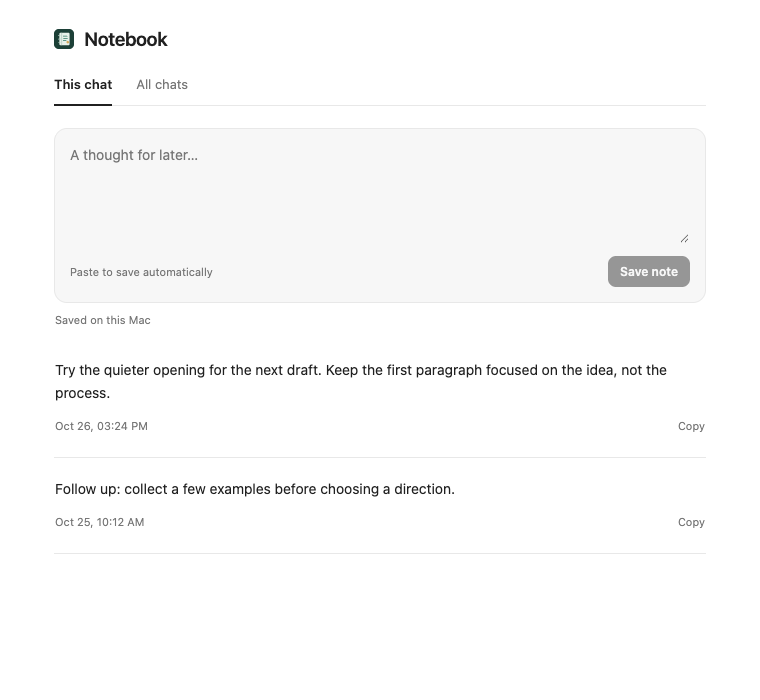

# Chat Notebook

A small local notebook for thoughts you want to keep alongside a Codex chat. Paste into the note field to save automatically, or type and choose **Save note**. Each note has a timestamp and is associated with a chat. **All chats** brings your notes together, with the current chat first. Copying a note puts its text on the clipboard; it does not send a message.



*Browser preview with example notes; not a Codex host capture.*

## Get started

Chat Notebook currently runs as a local Codex desktop plugin on macOS. Preparing it requires Node.js 24 or later and npm.

Clone or download this repository, open a terminal in its root, and prepare the plugin:

```sh
cd plugins/chat-notebook
npm ci
npm run build
npm run prepare-runtime
cd ../..
codex plugin marketplace add "$PWD"
```

Restart Codex, then install **Chat Notebook** from the **Chat Notebook** marketplace in the desktop Plugins Directory. Open a chat, then choose **new side-panel tab → More tools → Open chat notebook**. Codex starts the plugin as a local process; you do not need to run a separate server.

**Send the first message before saving notes for a new chat.** Notes saved in an empty composer can remain visible under **All chats** but lose their association with that chat after the panel is reopened.

The marketplace definition is included at `.agents/plugins/marketplace.json`. Keep the local checkout available: the generated build, runtime and dependencies are not tracked in Git. `prepare-runtime` copies the Node executable used to run it, so prepare the plugin on the Mac and architecture where you will use it. Refresh or reinstall the local plugin after rebuilding it; if the old tool catalog remains, restart the desktop app. This source checkout must be prepared locally before installation; adding its GitHub URL directly does not run the build.

## Using the notebook

- Paste into the field to save its resulting contents, including any draft already there. Type a note and select **Save note**, or press Command+Enter, to save manually.
- Switch between **This chat** and **All chats** to browse saved notes. Use **Copy** to put a note on the clipboard.
- Existing notes cannot yet be edited or deleted in the notebook. Unsaved text remains only while the panel is open.
- Notes are associated with the chat ID supplied by Codex; the plugin does not migrate notes if that ID changes. It does not capture a conversation snapshot or add notes to the model's context.

## Storage and privacy

Notes are stored locally in a SQLite database at:

```text
~/Library/Application Support/Plugin UI Lab/Chat Notebook/notes.sqlite
```

The database contains note text, timestamps, note IDs and chat IDs. It is not encrypted by the plugin. Set `CHAT_NOTEBOOK_DATA_DIR` to use a different directory. The plugin does not write notes into Codex's database. Clipboard text is captured when you paste into the field; copying uses the clipboard.

## Development

From `plugins/chat-notebook`, run the storage tests with `npm test`. For a layout-only browser preview, run `npm start` and visit `http://127.0.0.1:3877/preview`. Saving is disabled in the preview. This local HTTP mode is separate from the installed plugin's stdio process.

The original parent-repository plugin was tested in a macOS virtual machine, including reopening notes saved after the first message. This standalone marketplace layout has not yet been tested in the desktop app. The empty-composer limitation above was also observed there. Host behavior and available plugin surfaces may change.
